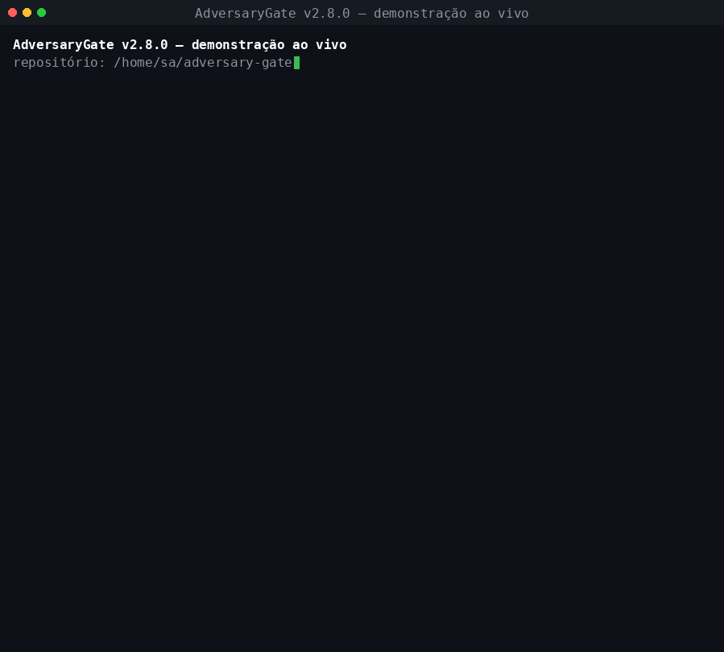

# AdversaryGate

[](https://pypi.org/project/adversary-gate/)
[](LICENSE)
[](https://github.com/Sanflow10/adversary-gate/actions/workflows/ci.yml)

> **High AI usage ≠ high confidence.** The cost of an agentic coding pipeline is
> not the model's intelligence — it is the pipeline's self-deception.

A fail-closed verification gate for patches written by AI coding agents. It runs your tests on the baseline and on the patch, mutation-tests only the lines the patch wrote, and answers `MERGE`, `BLOCK` or `INCONCLUSIVE` — where **uncertainty is a first-class result** instead of a silent approval. CLI, GitHub Action and MCP server.

**Python only, for now.** It measures Python/pytest repositories; on other stacks it runs your suite via `--test-command` but answers `INCONCLUSIVE`, never `MERGE` — see [Language support](docs/LANGUAGE_SUPPORT.md).

```bash
pip install adversary-gate
```

---

## 🎬 Watch it decide (60 seconds)



**B and C are the same patch.** Same code, same tests, same execution. The only difference is that C brought evidence (`--diff` + `--coverage-json`); B brought none.

| | Patch | Coverage evidence | Decision | Exit |
|---|---|---|---|---|
| **A** | breaks the test | declared `untrusted` | `BLOCK` | 1 |
| **B** | clean | none — never measured | `INCONCLUSIVE` | 2 |
| **C** | clean | measured, both artefacts SHA-256'd | `MERGE` | 0 |

That middle row is the whole product. An unproduced measurement is not a measurement, so it cannot clear a floor — and a number nobody can re-derive is an opinion with a false precision label.

```bash
python3 demo/demo.py          # runs the three scenarios; exits non-zero if one regresses
python3 demo/render_gif.py    # rebuilds demo/demo.gif from the captured frames
```

`demo/demo.py` is an **acceptance test**, not a screenshot: it builds the fixtures, runs the real CLI as a subprocess, reads the real exit codes, and fails if any of the three decisions changes. Its evidence artefacts are checked in under `demo/out/`.

> **`INCONCLUSIVE` is not an error.** It is the gate saying *"I did not measure that"*, and it is exit 2 so CI treats it as "do not merge yet", not as "pass". See [How `diff_coverage` gets its value](docs/HOW_IT_DECIDES.md#how-diff_coverage-gets-its-value) for the one-step path from `INCONCLUSIVE` to `MERGE`.

---

## 🚀 Quick Start (CLI & GitHub Action)

### First run, in one minute

From the root of a git repository whose agent's change sits on top of `main`
(new files tracked: `git add -N` them), with `pip install adversary-gate coverage`:

```bash
BASE=main                                         # the commit before the agent's change
W=$(mktemp -d)
git worktree add -q "$W/before" "$BASE"           # the baseline, exactly as committed
git diff --no-ext-diff "$BASE" > "$W/changes.diff"  # baseline -> your working tree
coverage run -m pytest -q && coverage json -q -o "$W/coverage.json"
adversary-gate --baseline "$W/before" --patch . \
  --claim tests/test_shop.py::test_discount_never_negative \
  --diff "$W/changes.diff" --coverage-json "$W/coverage.json" > "$W/answer.json"
echo "exit $?"                                    # 0 MERGE, 1 BLOCK, 2 INCONCLUSIVE
python -c "import json,sys; a=json.load(open(sys.argv[1])); print(a['decision'], '-', a['reason'])" "$W/answer.json"
git worktree remove --force "$W/before"
```

Replace the `--claim` with the test that proves your fix (`path::test`). On a
correct **one-line** fix, expect this first answer:

```text
exit 2
inconclusive - every claim held and the fix is proven, but suite strength's lower bound is 0.38,
below the 0.75 floor (1/1 mutants killed): the change is too small to measure at this floor,
which takes at least 5 killed mutants; see next_steps
```

That is not a failure: the fix *is* proven, and the gate says plainly that it
could not measure how strong the tests are on a change this small. See
[Small changes](docs/HOW_IT_DECIDES.md#small-changes-why-a-correct-one-line-fix-is-inconclusive).

### Command-Line Usage

```bash
adversary-gate \
  --baseline /path/to/before \
  --patch /path/to/after \
  --test-path tests/test_auth.py \
  --test-id test_token_expiry \
  --diff changes.diff \
  --coverage-json coverage.json \
  --model "${AGENT_MODEL_NAME}" \
  --evidence-log evidence.jsonl \
  --report
```

Produce the two artefacts in your own pipeline, for example:

```bash
git diff --no-ext-diff baseline...patch > changes.diff
coverage json -o coverage.json          # after: coverage run -m pytest
```

#### Which tests? Name several, or let coverage say

One run verifies any number of claims, and the decision is over all of them
(one `REFUTED` blocks; one `UNVERIFIED` makes it `INCONCLUSIVE`):

```bash
adversary-gate ... --test-path tests/test_auth.py --test-id test_expiry --test-id test_refresh
adversary-gate ... --claim tests/test_auth.py::test_expiry --claim tests/test_api.py::TestLogin::test_ok
```

Or name none, and let the gate verify **the tests that executed a changed
source line** — read from coverage.py's per-test contexts, not guessed:

```bash
printf '[run]\ndynamic_context = test_function\n' > contexts.coveragerc
coverage run --rcfile=contexts.coveragerc -m pytest
coverage json --show-contexts -o coverage.json
adversary-gate --baseline before --patch after \
      --diff changes.diff --coverage-json coverage.json --discover-claims
```

A test file the patch **rewrote** is still picked, and judged with the
baseline's copy of it (the baseline oracle, above); it is named under
`discovery` (`rewritten_test_files_judged_by_baseline`), next to anything that
could not be resolved to a node id, and the cap
(`--max-claims`, default 10) with how many it cut. From 3.0.9 a cut test is not left unjudged: with the full suite off (`--full-suite-path ""`), a patch whose kept claims would merge is `INCONCLUSIVE` instead, and the reason says to raise the cap or run the suite. A report recorded without
contexts is a usage error (exit 3), not "no tests".

#### Your project's interpreter, its limits, its environment

```bash
adversary-gate ... --python .venv/bin/python \
      --timeout 120 --cpu-seconds 60 --memory 2G \
      --pass-env PATH --env PYTEST_DISABLE_PLUGIN_AUTOLOAD=1
```

| Flag | Default | |
| --- | --- | --- |
| `--python` | the gate's own | the interpreter pytest runs on — the one your dependencies are in |
| `--timeout` | `30` | wall-clock seconds per claim or mutant run; `none` removes it |
| `--cpu-seconds` | `10` | CPU seconds per claim or mutant run; `none` removes it |
| `--full-suite-timeout` | `900` | wall-clock seconds for the collateral full-suite run |
| `--full-suite-cpu-seconds` | none | CPU seconds for the collateral full-suite run |
| `--full-suite-memory` | `4G`; `none` on Android | address space for the collateral full-suite run |
| `--memory` | `512M`; `none` on Android | address space per run (`K`/`M`/`G`); `none` — the JVM and Node cannot start under one |
| `--pass-env NAME` | — | copy a variable into the runs (they start from a minimal environment) |
| `--env NAME=VALUE` | — | set one |
| `--serial-sides` | off | run the baseline and patch sides of a check one after the other instead of together, and the full suite after the claims and mutants instead of alongside the claims; forces `--mutation-workers 1` (small machines; tests that share a fixed `/tmp` path or a port). The mutants never run beside the suite either way (AG-043) |
| `--mutation-workers N` | `1` | mutants at once, each on its own copy of the tree. Only for claims that share nothing outside the repository: two runs that meet on the same `/tmp` path, port or test database make one of them fail, and a failing run counts as a killed mutant (AG-043). Not with `--census-min-mutants` |

The same choices apply to every run — claims, mutants and the collateral suite —
except time and memory: the whole suite gets its own limits, because ones sized
for a single test killed every suite of real size on both sides (out of time, or
pytest dying with `MemoryError` under 512M of address space): never a MERGE (two failing
sides are unverifiable), but the regression the suite would have caught came
back INCONCLUSIVE instead of BLOCK (AG-033). The output records them under `execution`, with the **names** of the
variables and never their values. A run the memory limit killed (`MemoryError`,
`Fatal process out of memory`, `Could not reserve enough space`…) is reported as
the harness dying, not as a failing test: it says nothing about the patch.

#### Not a pytest suite, or running a patch you have not seen?

```bash
# 1. run your own command instead of pytest (any language, any runner)
adversary-gate --baseline before --patch after \
      --test-path run_tests.sh --test-command "./run_tests.sh"

# 2. wrap every run in bubblewrap: no network, private PID//tmp,
#    read-only system, only the repo writable
adversary-gate ... --sandbox bwrap

# 3. both together -- the usual shape for a patch from someone else
adversary-gate ... --test-command "make check" --sandbox bwrap \
      --require-network-isolation
```

`--test-command` needs no `--test-id` (there are no node IDs to name), and it
feeds the collateral full-suite run too unless you pass `--full-suite-command`.
`--sandbox bwrap` needs [bubblewrap](https://github.com/containers/bubblewrap)
installed and refuses to start without it — see
[Execution boundary](docs/EXECUTION_BOUNDARY.md)
for exactly what it does and does not contain.

Exit Codes for CI Integration:
- `0` — **`MERGE`**: Every claim executed cleanly and cleared coverage & suite strength floors.
- `1` — **`BLOCK`**: Regressions or collateral suite failures detected.
- `2` — **`INCONCLUSIVE`**: Infrastructure error, missing test, missing coverage evidence, or weak suite (blocks merge).
- `3` — **`USAGE_ERROR`**: Bad arguments, malformed JSON, or a coverage claim that was not declared as untrusted.

---

### GitHub Action Integration (`action.yml`)

**One ref in.** `base-sha` derives the baseline, the diff and the coverage
report itself, so the first thing you install is not a `INCONCLUSIVE`:

```yaml
name: Verification Gate

on: [pull_request]

jobs:
  verify-agent-patch:
    runs-on: ubuntu-latest
    steps:
      # base-sha is a commit in history: this is not optional.
      - uses: actions/checkout@v4
        with:
          fetch-depth: 0

      # Your Python, your dependencies -- the tests run here.
      - uses: actions/setup-python@v5
        with:
          python-version: '3.11'
      - run: pip install -r requirements.txt pytest coverage

      - name: Run AdversaryGate
        uses: Sanflow10/adversary-gate@v3
        with:
          base-sha: ${{ github.event.pull_request.base.sha }}
          evidence-log: 'evidence.jsonl'
```

No test is named: the Action records coverage per test and verifies the tests
that executed the lines the pull request changed. Name them yourself with
`claims` (one `path::test` per line) or `test-path` + `test-id` (one id per
line); either one turns discovery off unless `discover-claims: 'true'`.

**Any non-zero exit fails the step, and that is the safe default.** `BLOCK`
(1), `INCONCLUSIVE` (2) and a usage or harness error (3/4) all turn the check
red. Do not add `continue-on-error` and stop there: that lets a `BLOCK` through
along with everything else. If some pull requests are `INCONCLUSIVE` by nature
(a change to C++ or SQL, which the gate runs but cannot measure), keep the step
from failing and branch on the `exit-code` output instead (2.13.0 and later):

```yaml
      - name: Run AdversaryGate
        id: gate
        uses: Sanflow10/adversary-gate@v3
        continue-on-error: true
        with:
          base-sha: ${{ github.event.pull_request.base.sha }}

      - name: Act on the decision
        if: always()
        env:
          EXIT_CODE: ${{ steps.gate.outputs.exit-code }}
        run: |
          case "$EXIT_CODE" in
            0) echo "MERGE" ;;
            2) echo "::warning::INCONCLUSIVE: the gate could not measure this change; a human decides" ;;
            1) echo "::error::BLOCK"; exit 1 ;;
            *) echo "::error::the gate did not finish (exit '${EXIT_CODE}')"; exit 1 ;;
          esac
```

Branch on `exit-code`, not on `decision`: a run that printed no verdict (exit
3/4) still reports `decision: inconclusive`, and an empty `exit-code` means the
Action stopped before the gate ran. Let `2` pass only where you know the gate
cannot measure the change, for example with `paths:` on a separate workflow;
everywhere else, leave the default.

**It runs your tests on your Python.** The gate itself lives in a private venv
on its own 3.12, and your job's `python` is the same before and after the step.
The tests run on the first `python`/`python3` on `PATH` that can import pytest —
the one your `setup-python` step put there — or on the interpreter you name with
`python:`. When there is none, they run on the gate's own and the run says so.
`timeout`, `cpu-seconds`, `memory`, `pass-env` and `env` are the CLI flags
above.

> **Which ref?** `v3.0.17` carries every fix, and the Release workflow that
> publishes it also moves the floating `v3` tag, which follows every 3.x
> release. Versions before 3.0.4 are unsupported. `@main` follows `main` and picks up whatever lands
> next. For
> anything that matters, pin the full commit SHA instead
> (`uses: Sanflow10/adversary-gate@<full-sha>`), which cannot be moved under
> you.

What that does, and where each piece comes from:

| Artefact | Derived from |
|---|---|
| `baseline` | `<base-sha>`'s tree through a private index (`read-tree` + `checkout-index`) — every file as committed, no worktree leftovers; not `git archive`, which applies the repository's export attributes (AG-044) |
| `diff` | `git diff --no-ext-diff <base-sha>...HEAD` |
| `coverage-json` | `coverage-command`, run in the checkout under the gate's own boundary: the `sandbox` input, the minimal environment plus `pass-env`/`env`, and one fresh writable directory outside the repository (until 3.0.7 it ran as a bare shell step with the job's whole environment) |
| `patch` | the checkout itself |

If the ref is not in your local history the Action **stops with exit 4 and
tells you `fetch-depth: 0`** rather than measuring against a baseline it
invented. `coverage-command` defaults to `coverage run -m pytest` + `coverage json`
(with per-test contexts when claims are discovered), and `coverage` in it is
coverage.py on *your* interpreter — installed beside it, not into it, when it
is missing. Override it to point at your own suite, or pass `coverage-json` to
supply the artefact yourself.

**Everything it derived is one `git diff` you could have run by hand.** When
you would rather assemble it yourself — a monorepo, a generated diff, coverage
from a non-coverage.py tool — pass the paths explicitly instead:

```yaml
      - name: Collect coverage evidence
        run: |
          git diff --no-ext-diff ${{ github.event.pull_request.base.sha }}...HEAD > changes.diff
          python -m pip install pytest coverage
          coverage run -m pytest
          coverage json -o coverage.json

      - name: Run AdversaryGate
        uses: Sanflow10/adversary-gate@main
        with:
          baseline: './baseline'
          patch: './patch'
          test-path: 'tests/test_token_expiry.py'
          test-id: 'test_token_expiry'
          diff: 'changes.diff'
          coverage-json: 'coverage.json'
          coverage-floor: '0.80'
          suite-strength-floor: '0.75'
          model: '${{ matrix.model }}'
          evidence-log: 'evidence.jsonl'
```

Without `diff` + `coverage-json` (and without `base-sha` to derive them) the Action reports `INCONCLUSIVE`, because there is no coverage evidence to clear the floor with. If you deliberately want to assert the number instead, set `coverage-ratio` **and** `coverage-source: 'untrusted'`.

---

## 📦 Installation

```bash
pip install adversary-gate
```

Check what PyPI is serving before you trust it — `pip index versions
adversary-gate`. Versions before 3.0.4 are unsupported: each lacks fail-open
fixes (a patch reaching `MERGE` it should not) that came after it. PyPI gets a
release when a signed tag is pushed (Trusted Publishing, AG-008 closed), and
the GitHub Release below gets the same build. Every other route works too, and **none of
them needs PyPI**:

```bash
# straight from the repository
pip install git+https://github.com/Sanflow10/adversary-gate.git
```

```bash
# or clone it
git clone https://github.com/Sanflow10/adversary-gate.git
cd adversary-gate && pip install .
```

```bash
# or don't install it at all
PYTHONPATH=src python3 -m adversary_gate --help
```

| Route | Follows | Needs |
|---|---|---|
| `pip install git+https://…adversary-gate.git` | `main` | network |
| `git clone` + `pip install .` | `main` | git |
| `PYTHONPATH=src python3 -m adversary_gate --help` | `main` | nothing |
| `uses: Sanflow10/adversary-gate@main` | `main` | GitHub Actions |
| GitHub Release wheel (below) | **3.0.17** — every fix | nothing but `pip` |
| `pip install adversary-gate` (PyPI) | whatever PyPI has — check it first | network |

### Install a released wheel

`git+…` always follows `main`. For a fixed, versioned build there are two, and
today they carry the same code:

```bash
# PyPI -- 3.0.17. Versions before 3.0.4 are unsupported: each lacks fixes the
# CHANGELOG lists after it.
pip install adversary-gate==3.0.17
```

```bash
# GitHub Release -- 3.0.17: every fix in this document.
# The tag carries the "v", the filename does not.
pip install https://github.com/Sanflow10/adversary-gate/releases/download/v3.0.17/adversary_gate-3.0.17-py3-none-any.whl
```

The second is a plain public URL — no PyPI, no GitHub login, no `git` — and it
needs a **GitHub Release** for that tag to exist: if it answers `404`, the
Release for `v3.0.17` has not been published yet. A release
takes two steps, in this order, and only the first is done by hand:

1. **A person pushes a signed tag**: `git tag -s vX.Y.Z -m "X.Y.Z"` and
   `git push origin vX.Y.Z`. The push starts **Publish to PyPI**, which builds
   the tag's own tree — the core and the MCP package, `adversary-gate-mcp` —
   and uploads both through Trusted Publishing, so every file carries a PyPI
   provenance attestation. It refuses a tag whose `pyproject.toml` names
   another version, and it reads no API token. Before it builds anything it
   checks the tag's signature with `git verify-tag` against the key in the
   repository variable `RELEASE_ALLOWED_SIGNERS` (an `allowed_signers` line,
   kept outside the tree so a push cannot bring its own key): a lightweight
   tag, an annotated tag with no signature, a signature from another key, or
   no variable at all, and nothing is published.
2. **Actions → Release → Run workflow.** It refuses to run without that tag, or
   with one the same signature check refuses, and refuses while PyPI lacks either
   package. Then it runs the full test suite and **refuses to publish if it
   fails**, builds the wheel and sdist, installs the wheel into a clean
   interpreter, attaches them to the release, and moves the floating tag of the
   release's major line (`v3`) — only forward, so
   re-releasing an old version does not drag it back.

**Publish to PyPI → Run workflow** with a tag finishes a run that stopped
halfway: files already on PyPI are skipped, never replaced.

Until 3.0.3 the Release workflow created the tag itself, with the workflow's
token, and uploaded the core alone with an API token. Events from that token
start no other workflow, so for 3.0.2 and 3.0.3 the PyPI publisher never ran:
`uvx adversary-gate-mcp` kept serving 3.0.0, the core files carry no
attestation, and those tags are not signed. Like every version before 3.0.4,
they are unsupported.

### PyPI

Versions before 3.0.4 are unsupported. The audit this project grew from was run
against `2.0.1`, which predates every fix in this document: `--diff` and
`--coverage-json` did not exist yet (AG-002).

**AG-008 is closed (2026-10-04).** The Trusted Publisher is registered in the PyPI
project settings (`Sanflow10` / `adversary-gate` / `pypi-publish.yml`, no
environment), and `2.4.0` went up through it — OIDC, no token — with PyPI
provenance attestations attached to the wheel and the sdist. Until then the
upload step had failed on every tag with `invalid-publisher: valid token, but
no corresponding publisher`, and `2.2.0`/`2.3.0` never reached PyPI at all.

---

## 🤖 Coding agents: Hermes (MCP) and Jev (triage)

Two integrations, one rule: **nothing an integration says can make the gate more lenient.**

### An agent that cannot grade itself — MCP server (Hermes, any MCP client)

```bash
pip install "adversary-gate[mcp]"          # in an environment the agent cannot write to
# or, without installing anything:  uvx adversary-gate-mcp  (the same server, as its own PyPI package)
adversary-gate-mcp                         # stdio MCP server
adversary-gate-mcp --print-hermes-skill    # SKILL.md for ~/.hermes/skills/adversary-gate/
adversary-gate-mcp --print-hermes-config   # the mcp_servers block for ~/.hermes/config.yaml
```

Tools: `verify_repo(repo, claims?, pytest_args?, base_ref?)` and `gate_policy()`. `verify_repo` judges the repository's **working tree** — committed or not, untracked files included — against a baseline: it writes the baseline commit's tree into a scratch directory, every file as committed (not with `git archive`, which applies the repository's export attributes — AG-044), writes the diff, runs coverage.py with per-test contexts (data file in a scratch directory, nothing written into the repo), discovers the claims when none are named, and runs the gate. The answer carries `decision`, `mergeable`, `fix_proven`, every claim's `oracle`, and the full artefact.

**The agent says what to judge; the operator says how strictly, and against what.** The tool arguments name evidence only. Everything that decides the answer comes from the server's environment, set in the agent's MCP config by whoever runs it:

| Variable | Why the agent may not set it |
|---|---|
| `ADVERSARY_GATE_POLICY` | gate flags (`--sandbox bwrap`, `--triage jev`, floors). An agent that can pass `--coverage-floor 0` grades itself. Evidence flags here are refused. |
| `ADVERSARY_GATE_BASE_REF` | the baseline **is** the oracle: an agent could commit a rewritten test and name that commit as the base. Unpinned, the agent's `base_ref` (default `HEAD`) must already be on a remote-tracking branch — a commit the agent made locally is refused with `inconclusive` and nothing runs (3.0.11; before, any commit was taken) — and the answer says `"baseline_chosen_by": "agent"`. An agent that can push, or write `.git/refs/remotes`, gets past that check. Pinning names the baseline; it is not a defence against an agent that can write the repository's `.git` (its refs, objects or configuration) — run such an agent where it cannot, as with any code that runs with your privileges. |
| `ADVERSARY_GATE_PYTHON` | the interpreter's site-packages are harness too — a plugin installed there runs inside pytest. Use one the agent cannot write to. |
| `ADVERSARY_GATE_REQUIRE_PINNED_BASE` | `1` makes the pin above mandatory: without `ADVERSARY_GATE_BASE_REF`, `verify_repo` answers `inconclusive` and runs nothing, rather than judge against a baseline the agent named. Off by default, so servers that rely on `base_ref` keep working; `gate_policy` reports it as `baseline_pin_required`. |

`pytest_args` accepts test paths only; an option (`-p evil`) is refused. The shipped Hermes skill tells the agent to call the gate before saying "done", to fix code rather than tests on `block`, to never report `inconclusive` as success, and to promote a self-written skill only on `merge`.

### Risk triage with Jev (TypeSafe AI) — advice that can only tighten

```bash
export TYPESAFE_API_KEY=sk-...
adversary-gate ... --diff change.diff --triage jev     # --triage-threshold 0.70 by default
```

[Jev](https://www.datacamp.com/blog/system-one-models-jev) is a calibrated decision model: text and a schema in, a typed answer with a probability out, in ~100 ms. The gate asks it one *choice* (`low` / `medium` / `high` risk) and one *yes/no* (does this change a contract callers rely on?). A **confident `high`** raises this run's floors — strength confidence to 0.95, coverage floor to 0.90 — so a 5-of-5 mutant score that merges an ordinary change is `INCONCLUSIVE` for a risky one. A `low`, a `medium`, an unconfident `high`, an error or a timeout change **nothing**; there is no path from Jev's answer to a more lenient decision, which is what makes it safe to feed it text the patch's author wrote. The answer is recorded in `execution.triage` either way.

- **The diff leaves the machine** (truncated to 64 KiB, `https` only). That is why it is opt-in.
- Jev is early-access (launched 2026-09-15). The client follows TypeSafe's published request/response shape and is tested against a local server speaking it — **not** against the live API from this repository.

---

## 🎯 Why

Agents write fluent, plausible code, and naive pipelines that collapse infrastructure errors into "pass" approve patches whose tests are broken, never ran, or were rewritten to agree with the bug. Switching models does not fix that; deterministic verification does. AdversaryGate puts no LLM in the verifier: the same harness judges every patch, whichever model wrote it, and when it did not measure something it says so instead of showing a green check.


---

## 📚 Read more

| Document | What it is |
| --- | --- |
| 🧮 **[How it decides](docs/HOW_IT_DECIDES.md)** | the fail-closed model, decision matrix, `diff_coverage` and `suite_strength`, why a one-line fix is `INCONCLUSIVE`, exit-code taxonomy, provenance |
| 🌐 **[Language support](docs/LANGUAGE_SUPPORT.md)** | what happens on a repository that is not Python/pytest |
| 🛡️ **[Execution boundary](docs/EXECUTION_BOUNDARY.md)** | read before running it on untrusted code: `--sandbox bwrap` and its limits |
| ⏱️ **[Performance & compatibility](docs/PERFORMANCE_AND_COMPATIBILITY.md)** | timings, supported Pythons, deprecations |
| 📄 **[CHANGELOG](CHANGELOG.md)** | what changed in each version |
| 🔐 **[SECURITY](SECURITY.md)** | report a fail-open. A wrong `MERGE` is the whole failure mode, so a bug here *is* a security bug |
| 📋 **[Findings register](ERRORS_AND_INCONSISTENCIES.md)** | every finding against the gate itself, reproduced by real exit code before being fixed — and what is still open |


---

## 📄 License

Copyright © 2026 Sanflow ([Sanflow10](https://github.com/Sanflow10)).

Releases from 3.0.0 on are distributed under the [GNU Affero General Public License v3.0](LICENSE) (`AGPL-3.0-only`), with the additional terms that section 7 of that license allows — see [NOTICE](NOTICE). The 2.x line, up to and including 2.14.2, was published under the MIT License, and copies obtained under it keep that license. Only the latest release is distributed: the tags, GitHub Releases and PyPI files of earlier versions are no longer published.

For a commercial license without the AGPL obligations, write to sanflow086@gmail.com.
